# Water Quality Prediction: Read the Data Structure First, Then Ensemble

> Kaggle · ML Olympiad — Water Quality Prediction
> Metric: RMSLE · Final Private **0.05479** (submission `57913552`)

---

## Abstract

This task is to predict a continuous outcome from a set of anonymised water-quality measurements, scored by RMSLE. None of the 26 input fields comes with a physical description, so the starting point was not "use a more complex model" but **figure out what the data actually encodes**.

Three observations shaped every later design decision:

1. The numeric fields take only **24 distinct joint values** (after dropping `featureF`), and these map almost one-to-one onto `categoryE`.
2. `categoryA` and `categoryC` each map to essentially a single `unit` and `categoryE`, so the categorical fields form a **hierarchy**.
3. **35.6%** of test rows carry a `categoryC` never seen in training, while only **4.46%** of rows in local validation do.

Observations 1 and 2 led to the **conditional residual** and **hierarchical smoothing**; observation 3 led to **category-availability masking** during training. The final model is a fixed ensemble of three boosting libraries over the same feature set: 5 member configurations × 6 models = 30 fitted models, with weights chosen once on out-of-fold predictions and then frozen.

| Stage | Local OOF | Public | Private |
|---|---:|---:|---:|
| Constant prediction | 0.172644 | 0.16873 | 0.16823 |
| `unit` grouping only | 0.070556 | 0.07173 | 0.06946 |
| Random forest | 0.060689 | 0.06194 | 0.05980 |
| XGBoost, raw 26 features | 0.058795 | 0.06131 | 0.05951 |
| + conditional residual | 0.055119 | 0.05919 | 0.05796 |
| + residual bundle + masking | 0.053468 | 0.05813 | 0.05686 |
| CatBoost, hierarchical (best single) | 0.052566 | 0.05659 | **0.05496** |
| Five-member ensemble | **0.052083** | 0.05650 | **0.05479** |

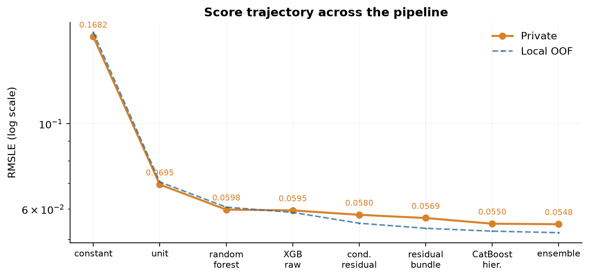

**Figure 0.** From the constant baseline to the final ensemble, Private falls from 0.16823 to 0.05479. The vertical axis is logarithmic because the first two steps span more than everything that follows combined.

---

### Contents

- [1. Exploratory data analysis](#1-exploratory-data-analysis)
- [2. Preprocessing](#2-preprocessing)
- [3. Feature engineering](#3-feature-engineering)
- [4. Single-model results](#4-single-model-results)
- [5. Ensemble](#5-ensemble)
- [6. Conclusions](#6-conclusions)
- [Appendix: reproduction](#appendix-reproduction)

---

## 1. Exploratory data analysis

### 1.1 Task and data

13,000 training rows and 7,000 test rows. Excluding `id` and the target `result`, there are **26 input fields**: 19 numeric (`featureA–I`, `compositionA–J`) and 7 categorical (`categoryA–F` and `unit`). The target lies in `[0, 1]`.

### 1.2 Target distribution: why take a logarithm

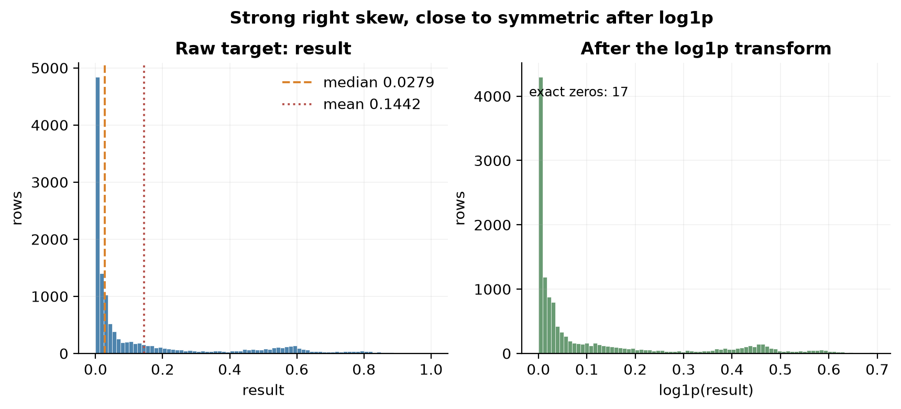

**Figure 1.** Left: the raw `result` is strongly right-skewed, with median 0.0279 far below the mean of 0.1442, and 17 exact zeros. Right: after `log1p` the distribution is close to symmetric.

This is not a generic "skewed target, so take logs" reflex. RMSLE *is* the mean squared error in `log1p` space, so training on `t = log1p(result)` puts the model's objective in the same space as the metric. Every model below fits `t` and inverts with `expm1`.

### 1.3 `unit`: the strongest and the most uneven grouping signal

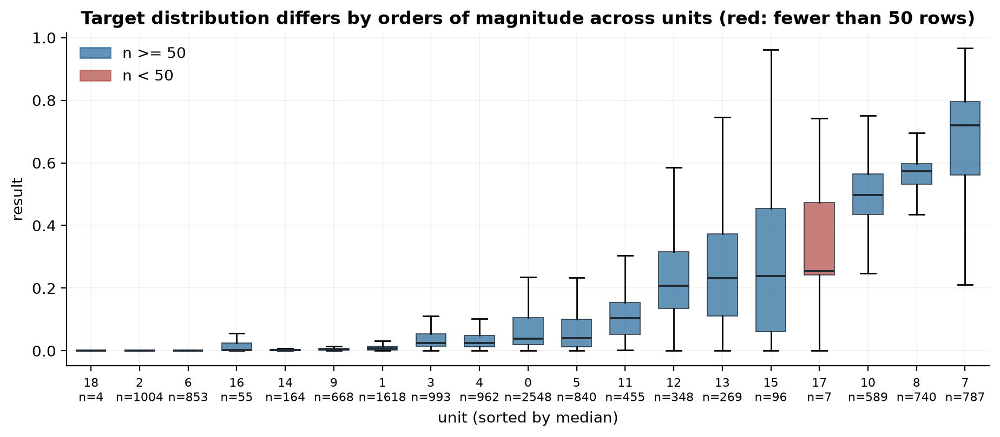

**Figure 2.** The 19 units differ enormously: `unit_6` has mean 0.0019 (853 rows) and `unit_7` has mean 0.6717 (787 rows), three orders of magnitude apart. Red marks units with fewer than 50 rows — `unit_18` has 4, `unit_17` has 7.

This alone explains why grouping by `unit` and nothing else drops RMSLE from 0.1726 to 0.0706. It also raises the first engineering problem: **ratios estimated from rare groups are unreliable**, so the design needs shrinkage toward a prior and an explicit fallback for unseen groups.

### 1.4 Cardinality: a problem that has to be handled up front

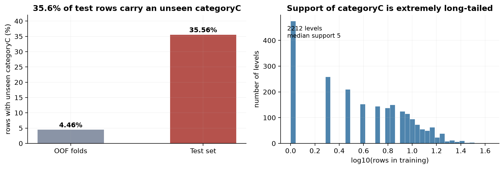

**Figure 3.** Left: 35.56% of test rows carry a `categoryC` absent from training, against 4.46% in the out-of-fold data. Right: `categoryC` has 2,212 levels with a median support in the single digits.

Together these two numbers define the central risk of the project: **local validation systematically understates the difficulty of the test set**. Any feature that depends on `categoryC` is unavailable for more than a third of test rows. This directly motivated the masking scheme in §3.6.

### 1.5 Train and test differ in specific, localised ways

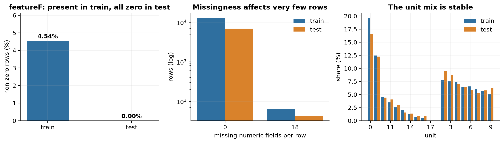

**Figure 4.** Left: `featureF` is non-zero for 590 training rows (4.54%) and for **none** of the test rows. Middle: missing numeric fields affect very few rows (64 in train, 43 in test). Right: the `unit` mix is essentially stable.

The three observations lead to three different conclusions:

- The `featureF` drift is real, but it does **not** by itself justify dropping the column — it may be a process variable that only appears in some batches. The later permutation experiments showed that removing it did not help on the leaderboard; that negative result is kept (§3.8).
- Missingness is sparse, so native missing handling is enough; no imputation model is warranted.
- Since `unit` is stable, a `unit`-based prior transfers from train to test.

### 1.6 The key finding: the numeric fields are redundant with `categoryE`

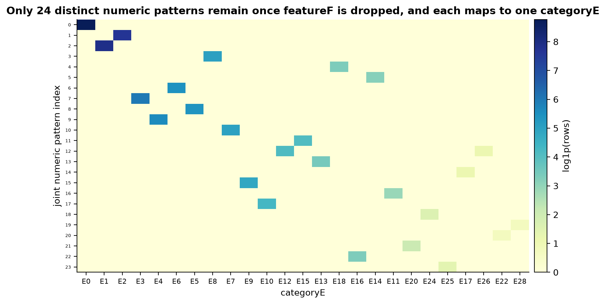

**Figure 5.** Rounding the 19 numeric columns to six decimals and dropping `featureF`, only **24** distinct joint values occur (85 with `featureF` included). These 24 patterns map almost one-to-one onto `categoryE`: 23 patterns belong to a single `categoryE`, and the remaining one — the missing-value pattern — belongs to two.

This is the most informative plot in the analysis:

> The 19 numeric fields are not 19 independent variables. Together they encode roughly 24 "measurement contexts", and `categoryE` already records the same thing at the categorical level.

Consequently the numeric features are highly redundant with `categoryE`, and adding more numeric interactions is close to pointless. The scarce information lives in the **categorical hierarchy**, not in the numeric dimension.

### 1.7 Missingness is not random

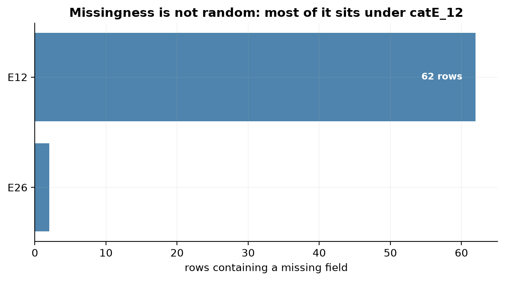

**Figure 6.** Of the 64 training rows with any missing field, 62 belong to `catE_12`. Missingness is concentrated under one category, which means it carries **group structure** rather than being scattered at random.

That suggests a simple but effective feature: the number of missing fields per row (`missing_numeric`), which encodes "which kind of measurement context this row belongs to" as a scalar.

### 1.8 From observation to hypothesis

| Observation | Hypothesis | Outcome |
|---|---|---|
| The `unit` distributions differ enormously | Group means carry strong signal but need smoothing | `unit_log` baseline reaches 0.0706; adopted |
| A→unit and C→E are near-unique | Statistics should shrink toward a parent group | Hierarchical prior gives consistent gains (§3.5) |
| Numeric patterns align with `categoryE` | Numeric fields are redundant with E | No dedicated numeric ablation, but permutation shows the raw numeric block contributes little |
| 35.6% unseen C in test | Simulate C being unavailable during training | Masking scheme (§3.6) |
| `featureF` present in train, zero in test | Drift; maybe drop the column | Dropping it made things worse — **hypothesis rejected** |

The last row deserves emphasis: it is a **hypothesis that the data rejected**, and it is kept in the record.

---

## 2. Preprocessing

### 2.1 Target transform and output clipping

- Training target is `t = log1p(result)`.
- Predictions are inverted with `expm1` and clipped to `[0, 1]`.

The clipping range comes from the training target, not from any observation of the test set. Every model applies the same transform, so scores across stages are directly comparable.

### 2.2 Categorical fields

The three libraries handle categories differently, so there are three paths:

| Model family | Handling |
|---|---|
| XGBoost | Cast to pandas `category`; levels fixed by the training fold; unseen values become missing and go through native categorical splits |
| LightGBM | Same, but declared as `category` dtype; unseen values treated as missing |
| CatBoost | Raw strings; unseen levels mapped to an empty string; native `cat_features` |
| Trees / linear (baselines) | Median imputation + one-hot; unseen levels encode to all zeros |

The binding constraint is that **the category vocabulary may only be fixed on the training fold**. New levels in the test set are always "unknown"; folding them into the vocabulary would be using future information to define the feature space.

### 2.3 Missing values

- XGBoost / LightGBM: keep `NaN` and rely on native missing-value splits; no global imputation.
- CatBoost: native missing handling.
- Baselines: median imputation inside the training fold.
- Two extra flag columns: `missing_numeric` (fields missing per row) and `featureF_nonzero`.

Global median imputation is deliberately avoided: missingness is structured (Figure 6), and imputing globally would erase that information.

### 2.4 Validation design: two nested levels

The requirement is a single sentence: **no row's target statistic may include its own label.** Three non-overlapping splits enforce it.

**Level one — outer evaluation.** All training rows are split by `KFold(5, shuffle=True, random_state=42)`. Fold k is the validation set and the other four folds form the training part. The outer loop is purely for evaluation: every prediction comes from a model that never saw that row.

**Level two — inner cross-fitting.** Inside each outer training part, the rows are split again five ways. Each row's inner block is held out in turn, and that row's group means, standard deviations, frequencies and residuals are fitted on the other four inner blocks only.

**Level three — the full mapping.** The outer training part also fits one complete mapping on all four folds, used to transform the outer validation rows and the test set. This mapping is separate from the inner cross-fit and must not be confused with it.

The resulting boundaries:

| Rows | Feature source | Sees its own label |
|---|---|---|
| Outer training rows | The other four inner blocks of the same fold | No |
| Outer validation rows | Mapping fitted on the whole outer training part | No |
| Test rows | The same mapping; never touches validation or test labels | No |

This is the part of the implementation that is easiest to get wrong and hardest to spot in code review. Once a target-encoded feature lets a row's label into its own encoding, validation scores become optimistic immediately, and the bug is invisible at the level of "does the code run?".

So the design is checked by an executable audit: add **+2** to one training row's label, regenerate every feature, and verify three things — that row's own encoded columns are **unchanged**, every other row in its inner block is **unchanged**, and rows outside the block **do change**. All three held. If the first one fails, the inner split leaks.

---

## 3. Feature engineering

### 3.1 The 63 columns

| Group | Count | Content |
|---|---:|---|
| Raw fields | 26 | 19 numeric + 7 categorical |
| Categorical crosses | 5 | `A×E`, `A×D`, `A×F`, `unit×E`, `B×D×F` |
| Auxiliary flags | 2 | `missing_numeric`, `featureF_nonzero` |
| Support | 12 | `log1p(count in the training fold)`, for 7 raw categoricals and 5 crosses |
| Group means | 7 | `unit`, `A`, `E`, `A×E`, `A×D`, `A×F`, `unit×E` |
| Group standard deviations | 7 | Same seven groups |
| Conditional residuals | 4 | See §3.3 and §3.4 |
| **Total** | **63** | 51 float32 + 12 categorical |

### 3.2 Smoothed group means

For any group `g`, the target statistic is a mean shrunk toward a prior:

```
m(g) = (Σ t_i∈g + s · p(g)) / (count(g) + s)
```

with `s = 10` and prior `p(g)`. Large groups are trusted, small groups fall back to the prior, and unseen groups take the prior outright. The within-group standard deviation is computed on the training part only, and set to zero for singleton groups.

### 3.3 Conditional residual: subtract the baseline first

The same `categoryC` can appear under different `A` and `unit` contexts. Its raw target mean therefore mixes in "which measurement this is". The conditional residual estimates the baseline first and aggregates only the deviation:

```
r_i        = t_i − m(A_i × E_i)
C_residual = Σ_{C_i = c} r_i / (count(c) + 10)
```

An unseen C falls back to 0, meaning "no evidence yet that this group deviates from its baseline".

A two-row example shows what this buys. The numbers below are already `log1p` targets:

| A×E group | baseline m(A×E) | C1's t | C1 residual | C2's t | C2 residual |
|---|---:|---:|---:|---:|---:|
| group one | 0.10 | 0.12 | +0.02 | 0.08 | −0.02 |
| group two | 0.50 | 0.54 | +0.04 | 0.46 | −0.04 |

C1 sits above its baseline in both contexts, totalling +0.06; C2 sits below in both, totalling −0.06. After smoothing with denominator `count + 10`, C1's residual feature is `0.06 / (2 + 10) = 0.005` and C2's is −0.005.

Averaging the raw `t` instead gives C1 `(0.12 + 0.54) / 2 = 0.33` and C2 `(0.08 + 0.46) / 2 = 0.27`. Almost all of that difference comes from *which A×E group each level happened to appear in*, not from C itself. That is precisely why plain target encoding fails and the conditional residual works.

This is the one clear, controlled feature-engineering win in the project: five-fold OOF improves from **0.058795** (raw features) to **0.055119**.

To be explicit about the negative result: **adding plain smoothed target encoding does not help.** Its OOF is 0.059348, worse than not adding it at all. What works is the specific form — subtract the baseline, then aggregate — not target encoding as a concept. The negative result is preserved in the ablation ladder in §3.7.

### 3.4 Residual bundle

Three more columns accompany the base residual:

- **Normalised by unit volatility**: `r_i / (std(t | unit_i) + 0.03)`, aggregated by C. The 0.03 guards against the denominator collapsing for low-variance units.
- **`A×C` and `unit×C` residuals**: the raw residual aggregated over finer combinations, with prior strength 3.

The first stops high-variance units from dominating the C statistics; the latter two keep fine-grained information while still shrinking toward zero. Adding all three lowers OOF from 0.055119 to **0.053433**. They were introduced together without per-column ablation, so no claim is made that each contributes equally.

### 3.5 Hierarchical priors

The early version shrank every group statistic toward the **global mean**. That is wrong when units live on different scales: `unit_6` has mean 0.0019 and `unit_7` has 0.6717, so pulling a sparse `A×E` group inside `unit_7` toward the global 0.144 is clearly inappropriate.

The final scheme is hierarchical:

| Group | Shrinks toward |
|---|---|
| `A` | `unit` mean |
| `A×E`, `A×D`, `A×F` | `A` mean |
| `unit×E` | `unit` mean |
| `E`, `unit` | global mean |

An unseen `A` falls back to its unit mean, and an unseen cross falls back to its parent group. The conditional residual baseline was switched to the hierarchical `A×E` mean accordingly.

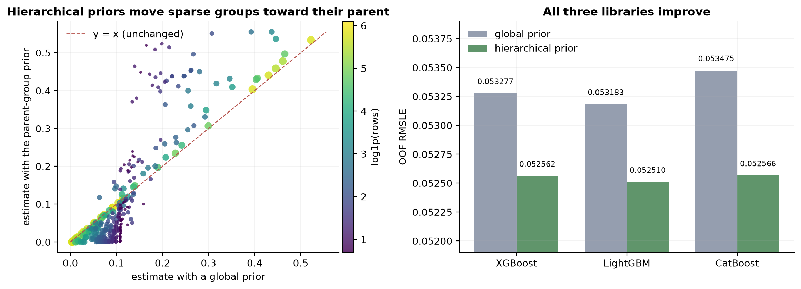

**Figure 7.** Left: each point is one `A×E` group; the horizontal axis is the global-prior estimate, the vertical axis the parent-prior estimate, and size/colour encode support. Many sparse groups sit well away from `y = x`. Right: with identical features, splits and training budget, all three libraries improve.

The consistent gain across all three libraries (about 0.0007) is what makes this change credible: unlike a single-model tweak, it is not easily explained by overfitting one particular implementation.

### 3.6 Category-availability masking

Addressing the risk from §1.4, training masks a fixed random 20% of rows:

- `categoryC` is set to missing;
- `freq_categoryC` is set to zero;
- all four C-related residual columns are set to zero.

Nothing is masked at validation, test or inference time. Genuinely unseen levels arise naturally from "training vocabulary → missing" and use the fallback statistics.

This is **covariate regularisation**: it changes no labels, uses no test information, and simply shows the model the "C unavailable" input shape during training. The 20%–30% band is an engineering judgement based on the observed 35.6% unseen rate, not a precisely tuned optimum.

### 3.7 The ablation ladder, including the rungs that failed

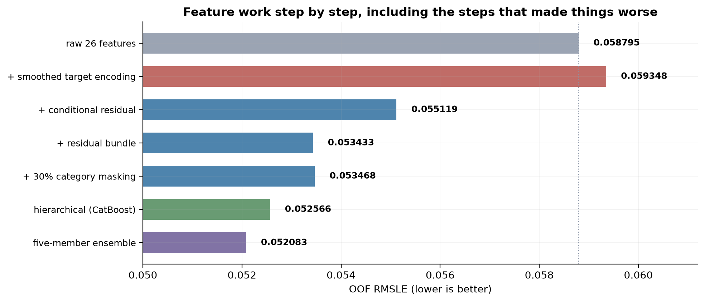

**Figure 8.** Each step changes one factor and holds the rest fixed. Note the second row: adding plain target encoding makes OOF **worse**.

| Configuration | Five-fold OOF |
|---|---:|
| Raw 26 features, depth 4 | 0.058795 |
| + plain smoothed mean/std encoding | 0.059348 (**worse**) |
| + conditional residual, depth 4 | 0.055119 |
| + conditional residual, depth 3 | 0.055284 |
| + residual bundle, depth 4 | 0.053433 |
| + residual bundle + 15% masking | 0.053358 |
| + residual bundle + 30% masking | 0.053468 |
| + residual bundle, raw target (no log) | 0.053815 |
| + residual bundle, depth 5 | 0.053340 |

The gap between 15% and 30% masking is 0.00011, and between depth 4 and depth 5 it is 0.00009 — both at the noise level, so neither should be claimed as a stable improvement. The final choice of 30% masking was made with the leaderboard in view as well, and that selection process is part of the record.

### 3.8 Permutation importance: what the models actually rely on

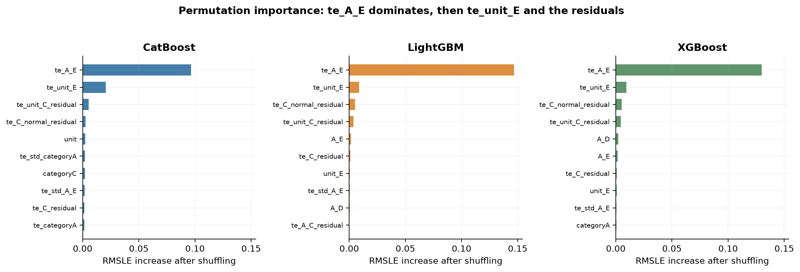

**Figure 9.** Computed on the 2,600 held-out rows of each fold, averaged over three repeats. The horizontal axis is the increase in validation RMSLE after shuffling a column.

| Input / feature group | CatBoost | LightGBM | XGBoost |
|---|---:|---:|---:|
| `te_A_E` | 0.096507 | 0.146781 | 0.129966 |
| `te_unit_E` | 0.020531 | 0.008766 | 0.009557 |
| four conditional residuals together | 0.011962 | 0.014982 | 0.014968 |
| target standard deviation group | 0.010530 | 0.001629 | 0.002007 |
| frequency group | 0.004079 | 0.000427 | 0.000469 |
| all raw numeric fields | 0.000715 | 0.000314 | 0.000306 |

The conclusion is unambiguous: **hierarchical conditional means and residuals carry almost all of the predictive information**, while the raw numeric fields contribute very little at the margin.

But there is a counterexample that has to be stated. The project retrained 11 pruned configurations:

| Strategy | CatBoost | LightGBM | XGBoost |
|---|---:|---:|---:|
| original 63 columns | 0.052566 | 0.052510 | 0.052474 |
| drop negative-and-unreliable (mean < 0, positive share ≤ 40%) | 0.052966 | 0.052576 | 0.052478 |
| drop all non-positive contributors | 0.052809 | 0.052546 | 0.052493 |
| keep top 45 | **0.052545** | **0.052490** | 0.052487 |

Dropping `featureE` alone from CatBoost — the single most negative contributor — changes OOF to **0.052707**, i.e. **worse**.

> **Permutation importance measures how much a fixed model depends on a column. It does not measure the expected gain from deleting that column.** Correlated features mask each other, and the surviving columns do not automatically absorb what was removed.

---

## 4. Single-model results

### 4.1 Baselines

All 11 fixed-parameter baselines were actually submitted. The table below is sorted by OOF:

| Method | OOF | Public | Private |
|---|---:|---:|---:|
| LightGBM, log target | 0.058667 | 0.06110 | 0.06041 |
| LightGBM, raw target | 0.059042 | 0.06121 | 0.06055 |
| CatBoost, log target | 0.059060 | 0.06190 | 0.05883 |
| CatBoost, raw target | 0.059384 | 0.06199 | 0.05880 |
| Random forest | 0.060689 | 0.06194 | 0.05980 |
| ExtraTrees | 0.061148 | 0.06197 | 0.05972 |
| Ridge regression | 0.063168 | 0.06567 | 0.06318 |
| Single decision tree | 0.063742 | 0.06406 | 0.06275 |
| `unit` grouping | 0.070556 | 0.07173 | 0.06946 |
| Constant (log) | 0.172644 | 0.16873 | 0.16823 |
| Constant (raw) | 0.173407 | 0.17024 | 0.16987 |

Two points stand out:

- **The constant model scores better on the leaderboard than locally** (0.16823 versus 0.172644). The reason is simple: with every row predicted identically, the error is almost entirely determined by the mean target level of the test set, which happens to be slightly below that of train.
- `unit_log` reaches 0.070556 using one column, a 59% reduction from 0.1726. This is Figure 2 restated as a number.

### 4.2 Progress on XGBoost

| Configuration | OOF | Public | Private | Trees |
|---|---:|---:|---:|---:|
| `base_d4`, raw 26 features | 0.058795 | 0.06131 | 0.05951 | 1375 |
| `residual_te_d4`, + conditional residual | 0.055119 | 0.05919 | 0.05796 | 726 |
| `more_drop15`, + bundle + 15% masking | 0.053358 | 0.05794 | 0.05696 | — |
| `more_drop30`, + bundle + 30% masking | 0.053468 | 0.05813 | **0.05686** | 637 |

`more_drop15` has slightly lower OOF than `more_drop30` but slightly higher Private. Differences of order 0.0001 are not stable and should not be treated as conclusions.

### 4.3 Three algorithms on identical features

To make "which algorithm is better" answerable, the features and splits must be fixed. Same 63 hierarchical columns, same outer five folds, same masking rate:

| Algorithm | OOF | Public | Private | Full-fit rounds |
|---|---:|---:|---:|---:|
| XGBoost (depth 5) | 0.052474 | 0.05675 | 0.05554 | 477 |
| LightGBM (31 leaves) | 0.052510 | 0.05716 | 0.05541 | 298 |
| CatBoost (depth 6) | 0.052566 | 0.05659 | **0.05496** | 1177 |

**The local and leaderboard orderings are exactly reversed**: OOF ranks XGBoost < LightGBM < CatBoost, while Private ranks CatBoost < LightGBM < XGBoost.

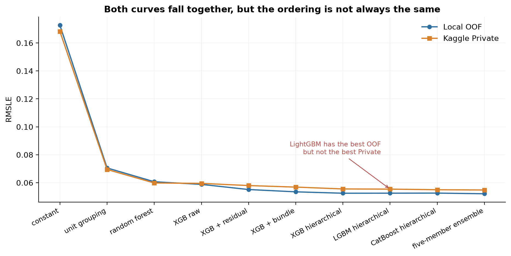

**Figure 10.** Score trajectory from the constant baseline to the final ensemble. The two curves fall together but cross near the end.

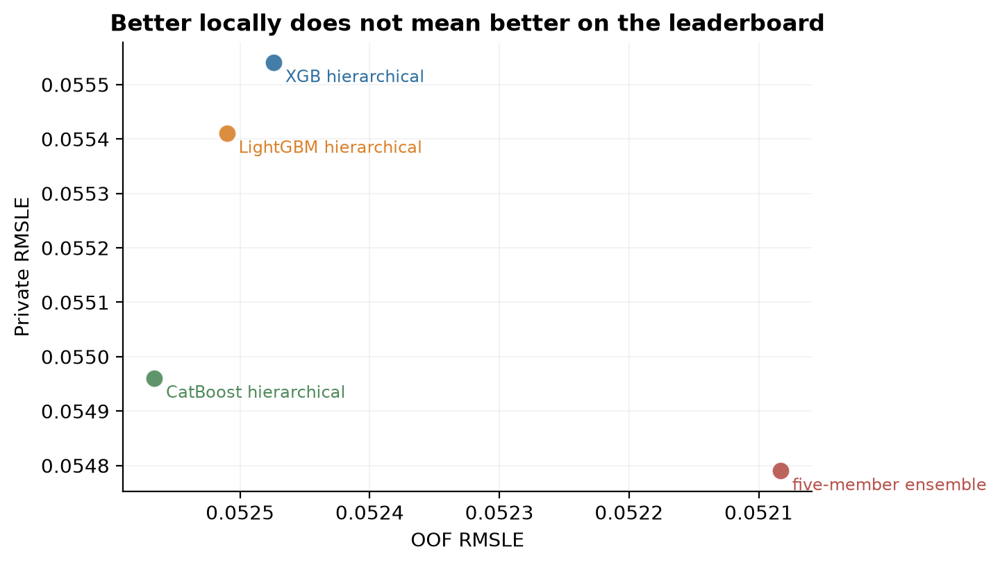

**Figure 11.** The four final candidates plotted by OOF against Private. Gaps are 0.0002–0.003 and the direction is inconsistent.

This is not a defect of any single model; it is **sampling noise in the test subsets**. The practical lesson: at the 0.05 level, a local difference of 0.0002 does not support "candidate A is better than candidate B".

### 4.4 Why the three algorithms differ

CatBoost's advantage on Private most plausibly comes from its treatment of categorical features: ordered boosting with native target statistics is more stable on a 2,212-level column than the split strategies of the other two. That is consistent with the permutation results, where CatBoost is visibly more dependent on the standard-deviation and frequency features — it is more sensitive to the shape of the distribution inside each level.

---

## 5. Ensemble

### 5.1 Architecture

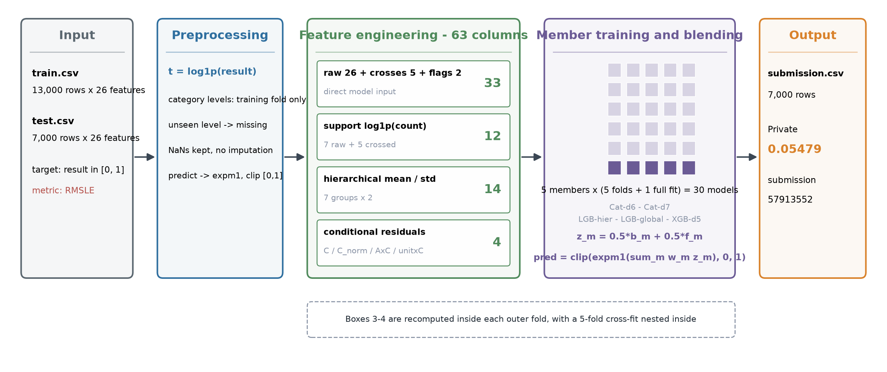

**Figure 12.** The full pipeline. Input is preprocessed and expanded to 63 features, then five member configurations are trained, each producing five fold models and one full-fit model — 30 models in total. At prediction time the fold and full-fit log predictions are averaged within a member, then combined by frozen weights and clipped. The dashed note records that the feature and training boxes are recomputed inside every outer fold.

Only two steps consult label information: the group statistics and residuals in feature engineering, and the model fitting itself. The former is confined to the outer training part and cross-fitted inside it; the latter is fitted on training folds only. The test set is transformed throughout and never fitted.

### 5.2 Members and weights

The final model uses 5 member configurations; each trains one model per outer fold plus one full-data model, for **30 fitted models**:

| Member | Library | Depth / leaves | Feature mode | Seed | Weight |
|---|---|---|---:|---:|---:|
| `catboost_depth6` | CatBoost | depth 6 | hierarchical | 42 | 30.293% |
| `catboost_depth7` | CatBoost | depth 7 | hierarchical | 42 | 11.887% |
| `lightgbm_hierarchical` | LightGBM | 31 leaves | hierarchical | 42 | 29.737% |
| `lightgbm_global_prior` | LightGBM | 31 leaves | **non-hierarchical** | 42 | 14.464% |
| `xgboost_depth5` | XGBoost | depth 5 | hierarchical | **2026** | 13.619% |

`lightgbm_global_prior` deliberately keeps the older global prior — it is a diversity source, not an oversight.

Within each member, the log-space predictions of the five fold models are averaged into `b_m`, and the full-data prediction is `f_m`. Each contributes half:

```
z_m   = 0.5 * b_m + 0.5 * f_m
pred  = clip(expm1(Σ_m w_m * z_m), 0, 1)
```

The weights solve a constrained least-squares problem on the OOF predictions — non-negative, summing to one, with a weak `1e-5` pull toward uniform — using SLSQP.

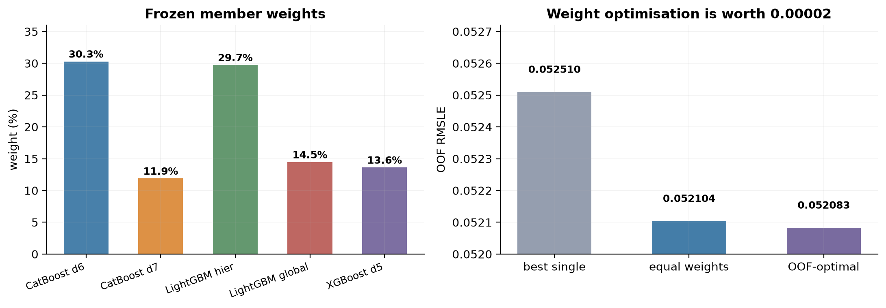

**Figure 13.** Left: the frozen member weights. Right: best single model → equal-weight average → OOF-optimised weights.

### 5.3 Why the ensemble gain is small: the errors are correlated

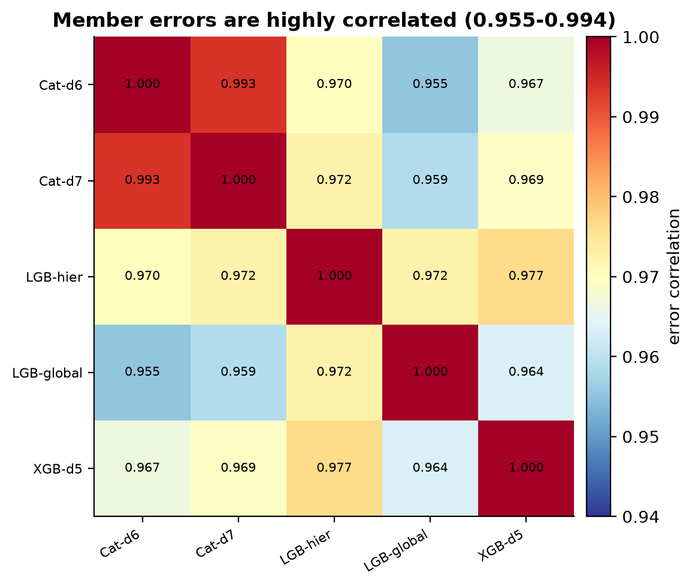

**Figure 14.** Correlation matrix of the five members' OOF residuals, ranging from 0.955 to 0.994.

An ensemble only reduces error if its members **fail in different places**. Here every member trains on the same 63 columns, so the residuals move almost in lockstep — most likely all failing together on the same cold-start rows. Within a member, the correlation between the fold average and the full-fit prediction reaches **0.9991**.

With error correlation this high, no choice of weights can remove much variance. This also implies that **adding more members from the same distribution will not help**; it only adds inference cost.

### 5.4 What separates local 0.0521 from online 0.0548

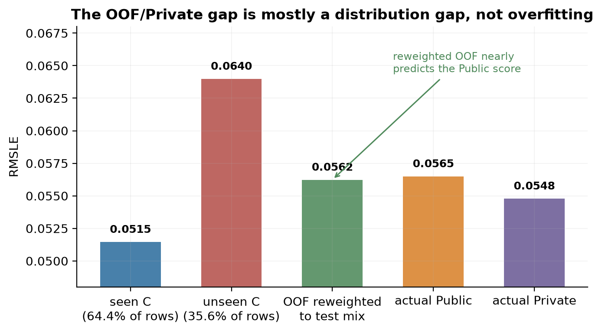

**Figure 15.** OOF errors split by whether C was seen in training, then reweighted to the 35.56% unseen share of the test set.

| Subset | OOF RMSLE |
|---|---:|
| `categoryC` seen (about 64.4% of rows) | 0.051460 |
| `categoryC` unseen (about 35.6% of rows) | 0.063987 |
| Reweighted to the test mix | **0.056235** |
| Actual Public | 0.056500 |
| Actual Private | 0.054790 |

The reweighted estimate of 0.0562 nearly coincides with the observed Public 0.0565. So the OOF-to-leaderboard gap is **mostly a distribution difference, not overfitting**: local validation contains too few unseen-C rows to reveal how hard the cold-start cases really are.

This analysis is useful on its own — it estimates how much the local score will be off *before* looking at the leaderboard.

### 5.5 Second round: better locally, worse online

Six further candidates were tried after the first round:

| Candidate | OOF | Public | Private |
|---|---:|---:|---:|
| Round 1: OOF weights + fold/full mix | 0.052083 | 0.05650 | **0.05479** |
| Round 2: OOF weights + fold/full mix | 0.051954 | 0.05642 | 0.05487 |
| Round 2: separate weights for seen/unseen C | 0.051950 | 0.05662 | 0.05494 |

Round 2 lowered OOF to 0.051954 while Private slipped from 0.05479 to 0.05487.

At the 5e-5 level, local improvements no longer map reliably onto the leaderboard. Pushing further along the local score is more likely to fit noise than signal, so the project stopped at round 1.

---

## 6. Conclusions

### 6.1 What this work did

1. **Started from the data structure.** Numeric fields take only 24 joint forms, the categoricals are hierarchical, and 35.6% of test rows have unseen categories. These three facts determined the entire design.
2. **Turned observations into testable features.** The conditional residual — subtract the A×E baseline, then aggregate the deviation by C — was the one clear feature breakthrough, taking OOF from 0.058795 to 0.055119.
3. **Kept labels isolated.** Outer evaluation plus inner cross-fitting, verified by a label-perturbation audit rather than by inspection.
4. **Regularised against a known risk.** Category masking simulates the missing category information at test time instead of hoping the model generalises on its own.

### 6.2 Transferable lessons

1. **Read the data structure before choosing a model.** The three most valuable findings here came from `groupby` and `value_counts`; none came from a library call.
2. **Target encoding requires cross-fitting**, and it should be verified by changing one row's label and checking that the row's own features do not move — not by reading the code.
3. **Reweight validation scores to the test distribution before trusting them.** When category coverage differs sharply between train and test, raw OOF is systematically optimistic.
4. **Check error correlation before ensembling.** Members correlated at 0.99 give close to zero gain; adding more only adds inference cost.
5. **Importance is not deletability.** Permutation importance describes a fixed model's dependence, while deleting a column and retraining is a different question that must be measured.

---

## Appendix: reproduction

```bash
pip install -r requirements.txt
# place train.csv / test.csv in data/

python final_ensemble/verify.py     # check the shipped submission
python final_ensemble/train.py      # train the 30 models (~3.5 min on CPU)
python final_ensemble/blend.py      # apply the frozen weights
python final_ensemble/predict.py    # rebuild the prediction from the models
```

Retraining from scratch in that repository reproduces the submitted file to within **4.7e-9** per row and the OOF score to within **5e-12**.

Code, frozen weights and the final submission file:

<https://github.com/ClaiiiiiirrrrrreeeeeBlue/water-quality-prediction-ml-olympiad>

where `submission/final_submission.csv` is the prediction of the final solution.
