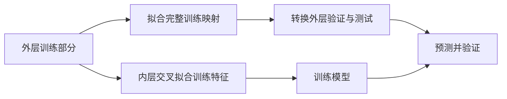

# 特征工程讲义：先扣除基准，再看偏差

## 要回答的问题

同一个 C 分组可能包含不同 A、不同单位的测量。直接比较 C 的平均目标，会混入“测量项目不同”带来的差别。我们先估计 A×E 条件下的水平，再汇总剩余偏差。

这些字母只是匿名分组，不能未经证实说 A 就是某个污染物、C 就是某个站点。

## 第一步：对数目标

令 `t = log1p(result)`。RMSLE 比较的也是 log1p 空间的误差，所以模型拟合 t，预测后用 expm1 还原。

## 第二步：组均值与平滑

`m(g) = (sum(t in g) + 10 × 全局均值) / (count(g) + 10)`。

count 很大时更相信本组；count 很小时更相信先验。本课先验为全局均值，后面的层级课会改成父组均值。

除 A×E 外，模型还收到 unit、A、E、A×D、A×F、unit×E 的组均值和标准差，以及交叉类别与频数。这些都是从训练部分计算的统计。

## 第三步：条件残差

`r_i = t_i - m(A_i × E_i)`。

再按 C 计算：`C_residual(c) = sum(r_i in c) / (count(c) + 10)`。新 C 回退为 0，含义是暂时没有证据表明它偏离已知基准。

手算示意（这里的 t 已经是对数目标，基准假设已知）：

| A/E 组 | 基准 | C1 的 t | C1 残差 | C2 的 t | C2 残差 |
|---|---:|---:|---:|---:|---:|
| 第一组 | 0.10 | 0.12 | +0.02 | 0.08 | -0.02 |
| 第二组 | 0.50 | 0.54 | +0.04 | 0.46 | -0.04 |

C1 残差和为 +0.06，经平滑是 0.06/(2+10)=0.005；C2 为 -0.005。我们提取的是相对各自基准的方向，而不只是混合后的绝对均值。

## 第四步：为什么要两层划分

外层五折负责评估模型。外层训练部分内再分五折，对训练样本做交叉拟合编码：一行标签不能参与它自己的组均值、标准差或残差特征。

外层验证和测试只读取“外层训练部分”拟合的映射；完全不能用验证或测试标签生成这些特征。

## 如何解释成绩

04 到 05 同时增加了交叉、频数、均值、标准差和条件残差，不能把全部分数变化归给一个新列。项目曾做过单列消融：只有普通组统计的 XGB OOF 约 0.059348，加 C 条件残差后约 0.055119。课程练习也应固定其余因素，再验证删去该列的影响。

本课 60 列：26 个原始字段 + 5 个交叉类别 + 2 个辅助标记 + 12 个频数 + 14 个均值/标准差 + 1 个条件残差。
